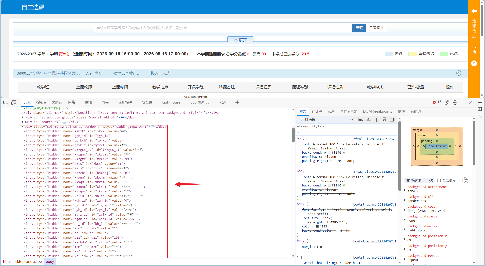

<h1>GdpuSeizingCourses</h1>
<h2>v0.1</h2>

A powerful tool to help you seize courses.  

**English** | [**中文简体**](./doc/README.cn.md)

---

## Features

- Enter the system in advance and fill in the parameters
- No need for long, repetitive refreshing and clicking; directly send requests once course seizing begins
- Seize courses at least **100%** faster
- WebUI interface with visual operation

## Usage

1. Download the complete project to your local machine
2. Enter the `script` directory, double-click to run the `runNginxAndServer.bat` file, and keep the command-line window running in the background
3. Open a browser and visit [http://localhost](http://localhost) to load the web page
4. Navigate to the Seize page
5. Go to the course-selection page on the [GDPU Academic Affairs System](https://jwsys.gdpu.edu.cn) **30 minutes before course selection begins**, and prepare to collect the parameters
6. Query the course list and open the course you want to select; keep that course expanded while leaving all other courses collapsed
7. Right-click anywhere on the course-selection page and click Inspect (or simply press F12) to open the developer tools; make sure you are on the **Elements** tab (the default position)
8. Press `Ctrl+F` and search for each parameter name listed on the Seize page for the two categories other than Account (or find them manually; they are usually located in hidden `input` tags, existing as `name` or `id` attributes), then copy the value of the `value` attribute from the tag containing them (excluding the double quotes). For an example of the tag image, please **refer to the notes below**
9. Repeat step 8 until you have filled in all parameters for the two categories other than Account
10. Open the `Application` tab in the developer tools, locate `Storage -> Cookie`, and open the cookie whose name contains `https://jwsys.gdpu.edu.cn/`; inside it you will find the two parameters for the Account category (route and JSESSIONID). Copy their values and fill them in
11. Switch the button to the desired operation (Select means seizing a course, Remove means dropping a course), and click Submit after course selection begins to seize the course
12. When you switch to a different course later, you only need to change the parameters in the Course category (different courses correspond to different Course-category parameters)
13. When shutting down, press `Ctrl+C` in the command line and enter `n` followed by `Enter` to cancel the interruption of the batch operation (otherwise nginx will keep occupying the background process). Then simply wait for the shutdown message to appear in the command line. If you accidentally closed the console, you can still double-click `stopNginx.bat` in the script/nginx directory to shut down the background nginx — it can be executed multiple times, until the console reports an error, which means no nginx process remains

## Notes

- This tool is only for **GDPU** yet
- This tool is currently in the **experimental stage**; success is not guaranteed. Actual behavior depends on the design of the university's academic affairs system, and in the worst case the tool may not work at all
- An error message on the page does not necessarily mean the seize/drop operation failed; it may simply be a response timeout caused by the school's academic affairs system being overloaded and processing very slowly, and the operation may have already succeeded
- The locations of the parameters required for the operation are shown below
  
